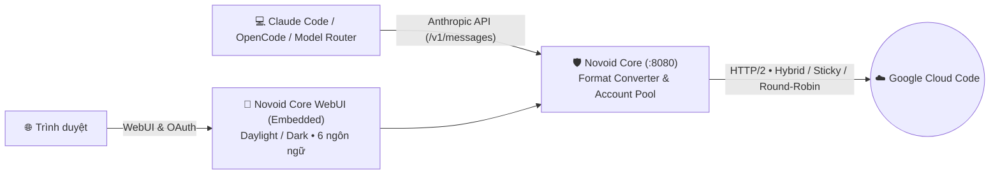

<div align="center">

# ⚡ Novoid Core

**Lõi proxy server viết bằng Rust tương thích Anthropic Messages API kết nối Google Cloud Code, tự động cân bằng tải đa tài khoản Google kèm WebUI quản trị nhúng sẵn.**

[](https://www.rust-lang.org/)
[](https://github.com/tokio-rs/axum)
[](https://tailwindcss.com/)
[](LICENSE)

</div>

---

## 🏗️ Kiến trúc hoạt động



* **Proxy Server (`src/server/` — cổng `8080`):**
  * Chuyển đổi hai chiều **Anthropic Messages API (`/v1/messages`)** ↔ **Google Cloud Code**, hỗ trợ streaming SSE, thinking blocks & signature cache, tool calling, schema sanitizer và prompt caching.
  * Sử dụng `reqwest` (`rustls` + HTTP/2 connection pooling) và cơ chế kiểm soát retry/cooldown chống spam khi upstream quá tải.
  * Hỗ trợ `--fallback` tự động chuyển sang model dự phòng khi model chính cạn quota.
* **Account Pool (`src/account/`):** Tự động xoay vòng nhiều tài khoản Google, làm mới OAuth token và theo dõi quota / rate-limit theo từng model tại `~/.config/novoid-core/accounts.json`.
* **WebUI (`Novoid Core` — `public/` nhúng trong binary):** Giao diện **Clean Daylight** mặc định kèm **Dark Mode**, hỗ trợ 6 ngôn ngữ (`vi`, `en`, `zh`, `id`, `pt`, `tr`), biểu đồ quota realtime, log SSE và luồng OAuth cho cả `localhost` lẫn domain public.

---

## 📂 Cấu trúc Repository

```text
novoid-core/
├── public/                     # WebUI frontend (được nhúng thẳng vào binary qua rust-embed)
│   ├── css/                    # Theme tokens & stylesheet biên dịch sẵn
│   ├── js/
│   │   ├── components/         # Dashboard, Accounts, Models, Logs, Server Config
│   │   └── translations/       # Đa ngôn ngữ (vi, en, zh, id, pt, tr)
│   ├── views/                  # Giao diện từng tab
│   └── index.html              # Shell chính của Novoid Core WebUI
├── src/
│   ├── account/                # Pool tài khoản, rate-limit, OAuth PKCE & chiến lược chọn tài khoản
│   ├── bin/acc.rs              # CLI shorthand `acc`
│   ├── cli/                    # CLI (clap) quản lý daemon & tài khoản
│   ├── cloudcode/              # Giao tiếp Google Cloud Code API, HTTP/2 & SSE streaming
│   ├── format/                 # Chuyển đổi Anthropic <-> Cloud Code, schema sanitizer & thinking utils
│   ├── server/                 # Axum server, WebUI API, OAuth callback & embedded assets
│   ├── utils/                  # HTTP client, Claude CLI config, presets & usage stats
│   ├── config.rs               # Đọc/ghi cấu hình runtime (~/.config/novoid-core/)
│   ├── constants.rs            # Hằng số, OAuth config, retry/cooldown, model fallback & presets
│   ├── error.rs                # Error enum có cấu trúc (NovoidError)
│   ├── logger.rs               # Logger kèm ring-buffer & SSE broadcast
│   ├── lib.rs                  # Thư viện dùng chung
│   └── main.rs                 # Entrypoint binary `novoid-core`
├── Cargo.toml
└── Cargo.lock
```

---

## 🎯 Chiến lược cân bằng tải & Endpoints

### 3 chiến lược chọn tài khoản (`--strategy`)

| Chiến lược | Mô tả | Phù hợp khi |
| :--- | :--- | :--- |
| `hybrid` *(mặc định)* | Chấm điểm kết hợp Health Score, Token Bucket, Quota còn lại và LRU | Dùng chung ổn định cho nhiều tài khoản |
| `sticky` | Giữ cố định tài khoản đang dùng, chỉ đổi khi rate-limit hoặc hết quota | Tối ưu **prompt caching** cho phiên dài |
| `round-robin` | Xoay vòng tuần tự qua các tài khoản khả dụng | Chia đều tải giữa các tài khoản |

### API Endpoints chính

| Method | Endpoint | Mô tả |
| :--- | :--- | :--- |
| `POST` | `/v1/messages` | Anthropic Messages API (streaming & non-streaming) |
| `GET` | `/v1/models` | Danh sách model khả dụng (định dạng OpenAI-compatible) |
| `GET` | `/health` | Kiểm tra trạng thái server và quota từng tài khoản |
| `GET` | `/account-limits` | Chi tiết quota & thời gian reset (`?format=table` để xuất bảng text) |
| `POST` | `/refresh-token` | Xóa cache và làm mới token |
| `GET` | `/` | Giao diện WebUI (`Novoid Core`) |
| `GET` | `/oauth-callback` | Endpoint nhận Google OAuth callback trên WebUI |

---

## 🚀 Cài đặt & Khởi chạy

1. **Build từ mã nguồn:**
   ```bash
   git clone https://github.com/hanovoid/novoid-core.git
   cd novoid-core
   cargo build --release
   ```
2. **Khởi chạy server:**
   ```bash
   ./target/release/novoid-core start --log --fallback
   # Hoặc cài toàn cục vào PATH để dùng lệnh `novoid-core` / `acc`:
   cargo install --path .
   acc start --log --fallback
   ```
   *Các lệnh CLI khác:* `acc ui` (mở WebUI), `acc status`, `acc restart`, `acc stop`, `acc accounts [add|list|verify|remove|clear]`.
3. **Nạp tài khoản Google:**
   * **Qua WebUI:** Mở `http://localhost:8080` → tab **Accounts → Connect Google Account** (hoặc **Import** file `accounts.json`).
   * **Qua CLI:** Chạy `acc accounts add` (hoặc `acc accounts add --no-browser` cho server không có giao diện).
   * *Khi deploy trên domain public:* WebUI tự chuyển sang chế độ `remote-loopback` (dán URL callback `localhost:51121` ngay trong modal), hoặc cấu hình `OAUTH_CLIENT_ID` + `OAUTH_CLIENT_SECRET` để redirect trực tiếp về domain public.

---

## ⚙️ Biến môi trường chính

| Biến | Mặc định | Mô tả |
| :--- | :--- | :--- |
| `PORT` / `HOST` | `8080` / `0.0.0.0` | Cổng và địa chỉ bind của server |
| `API_KEY` | *(trống)* | Bảo vệ các route `/v1/*` qua `Authorization: Bearer` hoặc `x-api-key` |
| `WEBUI_PASSWORD` | *(trống)* | Mật khẩu đăng nhập WebUI và các API `/api/*` |
| `ACCOUNT_STRATEGY` | `hybrid` | Chiến lược chọn tài khoản (`hybrid`, `sticky`, `round-robin`) |
| `FALLBACK` | `false` | Đặt `true` để bật model fallback khi hết quota |
| `OAUTH_CLIENT_ID` / `OAUTH_CLIENT_SECRET` | *(mặc định)* | Google OAuth Web Client tùy chỉnh cho domain public |
| `OAUTH_REDIRECT_URI` / `OAUTH_CALLBACK_PORT` | *(tự động)* / `51121` | Ghi đè Redirect URI hoặc cổng callback cục bộ |
| `HTTP_PROXY` / `HTTPS_PROXY` | *(trống)* | Proxy outbound cho các request tới Google API |

---

## 🔌 Kết nối nhanh với Claude Code CLI

```bash
export ANTHROPIC_BASE_URL="http://localhost:8080"
export ANTHROPIC_API_KEY="dummy"
claude
```

👉 Nếu bạn cần triển khai **hệ thống 2 tầng kèm Model Router (`novoid-*`) và script cài đặt cho 6 AI Coding CLI** (OpenCode, Claude Code, Aider, Goose, Codex CLI, Crush), xem thêm tại **[`hanovoid/antigravity-cloud`](https://github.com/hanovoid/antigravity-cloud)**.
