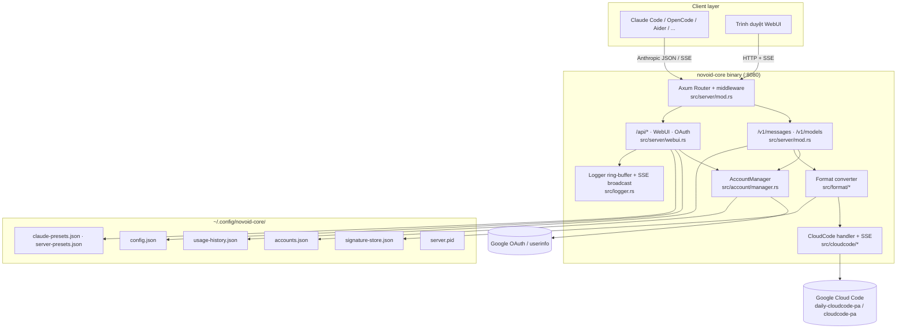
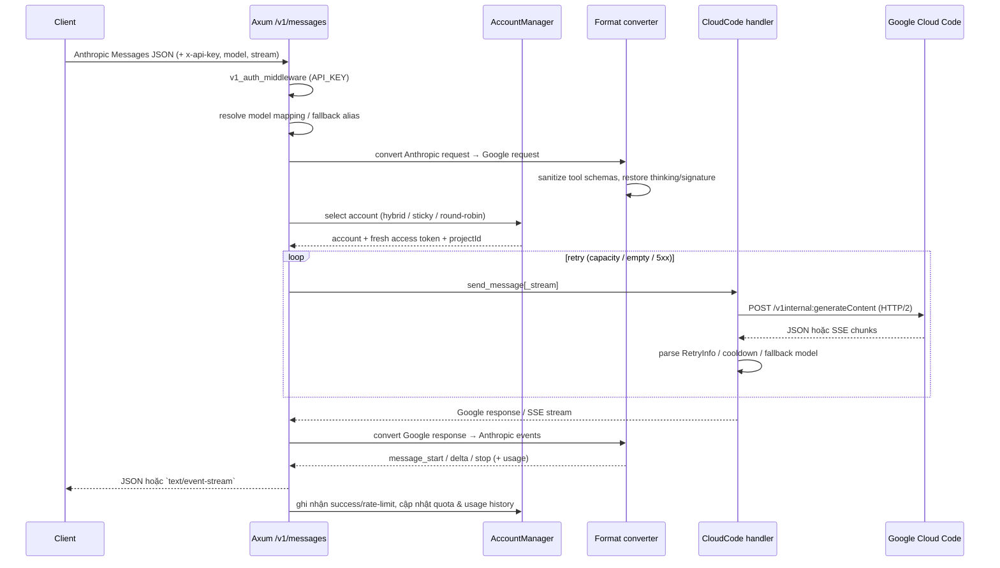

# 01 — Kiến trúc hệ thống

## 1. Tổng quan

Novoid Core là một **single binary Rust** đóng vai trò:

1. **API gateway** tương thích Anthropic Messages API (`POST /v1/messages`).
2. **Protocol translator** chuyển request/response giữa định dạng Anthropic và Google Cloud Code (`v1internal`).
3. **Account pool manager** quản lý nhiều tài khoản Google, tự làm mới OAuth token, theo dõi quota/rate-limit và chọn tài khoản tối ưu.
4. **Embedded WebUI** phục vụ trực tiếp từ binary (qua `rust-embed`) để cấu hình, thêm tài khoản, xem log realtime và quota.

## 2. Lớp runtime và module tương ứng

| Lớp | Module chính | Trách nhiệm |
| :--- | :--- | :--- |
| Entrypoint | `src/main.rs`, `src/bin/acc.rs`, `src/cli/mod.rs` | Parse CLI, daemonize (`start`/`stop`/`restart`), khởi động Axum, xử lý tín hiệu shutdown |
| HTTP server | `src/server/mod.rs`, `src/server/assets.rs` | Router, auth middleware, body limit 50 MB, CORS, request logging, quota cache 10s |
| WebUI API | `src/server/webui.rs` | Account CRUD/import/export, config & presets, Claude CLI config, logs SSE, OAuth flow |
| Account | `src/account/*` | OAuth PKCE, token refresh, project discovery, storage atomic, chiến lược chọn tài khoản, trackers |
| Format | `src/format/*` | Anthropic ↔ Google request/response, tool schema sanitizer, thinking & signature cache |
| Cloud Code | `src/cloudcode/*` | HTTP upstream, retry/backoff, rate-limit parser, model registry/quota, SSE streaming, sessionId |
| Utils | `src/utils/*`, `src/config.rs`, `src/constants.rs`, `src/error.rs`, `src/logger.rs` | Cấu hình, hằng số, lỗi chuẩn, HTTP client, presets, usage stats |
| Frontend | `public/*` | Alpine.js SPA nhúng trong binary qua `rust-embed` |

## 3. Vòng đời một request `POST /v1/messages`

### Các bước chi tiết

1. **Auth:** nếu `api_key` được cấu hình, mọi `/v1/*` yêu cầu `Authorization: Bearer <key>` hoặc `x-api-key: <key>`; nếu trống thì bỏ qua xác thực.
2. **Model resolution:** `model_mapping` trong config và built-in mapping (`claude-3-5-sonnet-20241022` → `claude-sonnet-4-6`, v.v.) được áp dụng trước khi convert.
3. **Request conversion:** `src/format/request.rs` + `content.rs` chuyển `messages[]`, `system`, `tools`, `tool_choice`; `schema_sanitizer.rs` chuẩn hóa JSON Schema; `thinking.rs`/`signature_cache.rs` khôi phục thinking block cho tool-loop.
4. **Account selection:** `AccountManager::select_account` dùng strategy được cấu hình; với `hybrid`, điểm = `health*w_health + tokens*w_tokens + quota*w_quota + lru*w_lru` với 4 nấc fallback (`Normal → Quota → Emergency → LastResort`).
5. **Upstream call:** `src/cloudcode/handler.rs` thử endpoint `daily-cloudcode-pa.googleapis.com` rồi `cloudcode-pa.googleapis.com`; xử lý `429`, `503/529 MODEL_CAPACITY_EXHAUSTED`, empty response, retry config `max_retries`.
6. **Response conversion:** `src/format/response.rs` + `sse_streamer.rs` phát các event Anthropic; non-streaming với thinking model được tổng hợp từ SSE.
7. **Telemetry:** `usage_stats` ghi `usage-history.json`; logger broadcast log tới `/api/logs/stream`; cache `/account-limits` bị invalidate.

## 4. Luồng dữ liệu & trạng thái

| Trạng thái | Nơi lưu | Vòng đời |
| :--- | :--- | :--- |
| Config runtime | `config.json`, `OnceLock<RwLock<AppConfig>>` | Load lúc khởi động; ghi atomic qua `config.json.tmp` → rename |
| Accounts + refresh token + quota | `accounts.json` | Load lazy khi `ensure_initialized()`, cache token/project trong RAM, atomic save |
| Usage history | `usage-history.json` | Ghi nối theo request, đọc qua `/api/stats/history` |
| Thinking/tool signatures | `signature-store.json` | LRU cache, clear qua `POST /test/clear-signature-cache` |
| Presets Claude / server | `claude-presets.json`, `server-presets.json` | CRUD qua `/api/claude/presets`, `/api/server/presets` |
| PID daemon | `server.pid` | Ghi lúc `start`, xóa lúc `stop`; `status` kiểm tra `/proc/<pid>` |
| Log ring buffer | RAM (1000 dòng) | `broadcast::channel(512)` tới SSE `/api/logs/stream` |
| Quota response cache | RAM (10s) | `/account-limits`, single-flight lock tránh stampede |
| Model list cache | RAM (5 phút) | `fetchAvailableModels`, single-flight |
| Rate-limit state | RAM | Reset sau `RATE_LIMIT_STATE_RESET_MS = 120s` (có thể override) |
| Unsupported model cache | RAM (10 phút) | Tránh gọi lại model bị `MODEL_NOT_SUPPORTED` |

## 5. Đa tiến trình & đồng bộ

- **Daemon mode:** `novoid-core start` spawn chính binary với `serve`, stdin/stdout/stderr bị triệt tiêu, PID lưu vào `server.pid`. `restart` gửi `SIGTERM` rồi spawn lại sau 1s.
- **Shutdown:** `server::trigger_shutdown()` phát qua `watch::channel`; CLI và server cùng subscribe để dừng graceful.
- **Single-flight:** model list, subscription refresh, limits cache dùng `Mutex`/`HashSet` tránh nhiều request cùng gọi upstream cho một tài khoản.
- **Throttling:** nếu bật `requestThrottlingEnabled`, mỗi upstream call bị delay `requestDelayMs` (mặc định 200ms) — hữu ích khi tài khoản dễ dính `429`.
- **HTTP client (`utils::http_client()`):** connect timeout 15s, TCP keepalive 30s + nodelay, HTTP/2 adaptive window, keepalive 20s/10s (kể cả idle), pool idle timeout 90s, tối đa 16 connection idle/host. Builder lỗi thì fall back `Client::new()`.
- **Background tasks:** signature flush mỗi 10s; usage flush/prune mỗi 60s (giữ 30 ngày); rate-limit state cleanup mỗi 60s. Khi shutdown: flush signature đồng bộ + flush usage, kèm watcher 1.2s cho keep-alive connections.

## 6. Bảo mật & ranh giới tin cậy

- `API_KEY` bảo vệ `/v1/*`; `WEBUI_PASSWORD` bảo vệ `/api/*` (ngoại trừ `GET /api/config` và `GET /api/auth/url` để WebUI khởi tạo), `/health` và `/account-limits`.
- Password/API key được che dạng `********` trong `GET /api/config`.
- `deep_merge` chặn các key nguy hiểm `__proto__`, `constructor`, `prototype` khi patch config.
- Body limit 50 MB; CORS cho phép mọi origin (phù hợp proxy local, cần siết lại khi deploy public).
- Refresh token và API key lưu plaintext trong `accounts.json` — cần cấp quyền file phù hợp trên server production.

## 7. Mở rộng & tích hợp

- Novoid Core **không** thực hiện tier routing; layer hai (`novoid-proxy`) nhận `novoid-*` model name và điều hướng sang tier tương ứng trước khi gọi Core. Xem <https://github.com/hanovoid/novoid-proxy>.
- Mọi harness (OpenCode, Claude Code, Aider, Goose, Codex CLI, Crush, IDE extension) chỉ cần nói Anthropic Messages API và trỏ `ANTHROPIC_BASE_URL` tới Core/proxy.
