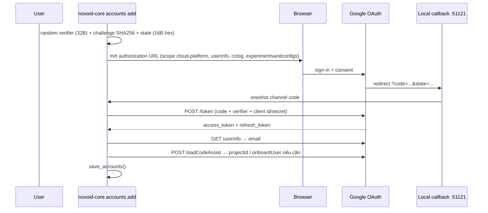

# 05 — Quản lý tài khoản & OAuth

Module: `src/account/*`. File runtime: `~/.config/novoid-core/accounts.json`.

## 1. Cấu trúc dữ liệu

`Account` (`src/account/types.rs`) — `#[serde(rename_all = "camelCase")]`:

| Field | Persistent | Ý nghĩa |
| :--- | :--- | :--- |
| `email` | ✅ | Định danh account (key dùng cho cache & API path) |
| `source` | ✅ | `"oauth"` hoặc `"manual"` (mặc định `oauth`) |
| `enabled` | ✅ | Có được chọn hay không (mặc định `true`) |
| `refreshToken` | ✅ | Refresh token, có thể chứa `refresh|projectId|managedProjectId` |
| `apiKey` | ✅ | API key (nếu account dạng manual) |
| `projectId` | ✅ | Cloud Code project ID |
| `addedAt` | ✅ | RFC3339 timestamp |
| `isInvalid` / `invalidReason` / `invalidAt` | ✅ | Trạng thái account bị vô hiệu hóa |
| `verifyUrl` | ✅ | Link xác thực lại nếu Google yêu cầu |
| `modelRateLimits` | ✅ | Map model → `{isRateLimited, resetTime, actualResetMs, markedAt}` |
| `lastUsed` | ✅ | Timestamp dùng cho LRU |
| `subscription` | ✅ | `{tier, projectId, detectedAt}` — `unknown`, `free`, `pro`, `ultra` |
| `quota` | ✅ | `{models: {model: {remainingFraction, resetTime}}, lastChecked}` |
| `quotaThreshold` / `modelQuotaThresholds` | ✅ | Ngưỡng quota riêng cho account/model |
| `consecutiveFailures`, `coolingDownUntil`, `cooldownReason` | ❌ (`#[serde(skip)]`) | Trạng thái runtime |
| `supportedModels`, `unsupportedModels` | ❌ | Cache runtime model support (10 phút cho unsupported) |

`AccountsFile = { accounts[], settings{}, activeIndex }`.

**Refresh token ghép:** `parse_refresh_parts()` tách `|`; `managed_project_id` (phần thứ 3) được ưu tiên dùng làm project ID mà không cần gọi upstream. `format_refresh_parts()` ghi lại khi discover được project mới.

## 2. Lưu trữ & tải

- `src/account/storage.rs`: `load_accounts(path)`, `save_accounts(path, accounts, settings, active_index)`.
- **Atomic write**: ghi `<file>.json.tmp` rồi `rename` → tránh file corrupt khi crash. Mutex global `WRITE_LOCK` serialize mọi lần ghi trong process.
- **Validation khi load:** account không có `verifyUrl` thì tự xóa cờ `isInvalid`/`invalidReason`; `activeIndex` ngoài khoảng được reset về 0. File thiếu/corrupt trả `AccountsFile::default()` kèm log — không làm crash startup.
- **Vệ sinh credential khi save:** account `source != "oauth"` bị bỏ `refreshToken`; account `source != "manual"` bị bỏ `apiKey` — tránh lộ credential sang nguồn khác.
- `AccountManager::ensure_initialized()` nạp lần đầu (double-checked flag + `init_lock`); `reload()` nạp lại sau import/toggle, **giữ lại token/project cache** nếu email + credential không đổi và account chưa invalid, nhưng tạo lại `StrategyImpl` (mất health/token bucket state).
- `select_account()` ghi `accounts.json` sau mỗi lần chọn thành công chỉ để lưu `last_used`.
- **Thứ tự ưu tiên strategy:** override constructor (`--strategy`) → env `ACCOUNT_STRATEGY` → config `accountSelection.strategy` → `hybrid`. Tên không hợp lệ rơi về hybrid.
- Token cache và project cache nằm trong RAM (`HashMap<email, String>`), TTL mặc định 50 phút (`tokenCacheTtlMs`).
- `src/utils/usage_stats.rs` flush định kỳ `usage-history.json`; `signature_cache.rs` flush định kỳ `signature-store.json`.

## 3. OAuth 2.0 PKCE

### 3.1 Luồng CLI (`accounts add`)



- Callback server bind `OAUTH_CALLBACK_PORT` (mặc định `51121`), fallback `51122–51126`.
- Với `--no-browser`: CLI in URL, người dùng dán callback URL hoặc code; `extract_code_from_input()` chấp nhận cả hai dạng.
- Callback server trả trang HTML success tự đóng sau 1.5s; lỗi trả HTTP 400; validate `state` khớp chính xác và `code` không rỗng. Dừng bằng `abort_tx` hoặc timeout (CLI: 120 giây).
- `refresh_access_token()` phân biệt lỗi mạng (`Err((msg, true))`) và lỗi HTTP/parse (`false`) để manager không đánh dấu invalid account khi mất kết nối tạm thời.
- `complete_oauth_flow()` = exchange code → userinfo → discover project; **project discovery thất bại không làm flow OAuth lỗi** (trả `project_id: None`).

### 3.2 Luồng WebUI

1. `GET /api/auth/url?local=0` → `AuthUrlResult` (url, verifier, state, redirect_uri) lưu trong `OAuthFlowStore.pending`.
2. Trình duyệt mở URL Google. Với domain public, WebUI dùng chế độ `remote-loopback`: hiển thị callback `http://localhost:51121/oauth-callback` để người dùng dán (`POST /api/auth/complete`).
3. `GET /oauth-callback?code&state` hoặc `POST /api/auth/complete {callbackInput, state}` → `complete_oauth_flow()` → lưu account → `OAuthFlowStore.completed[state] = success`.
4. WebUI poll `GET /api/auth/status?state=...` đến khi `success`/`error`.
5. `POST /api/auth/complete` bị hủy qua `abort_tx` nếu người dùng đóng modal.

### 3.3 Project discovery & subscription

- `discover_project_id()` (dùng lúc thêm account): thử `loadCodeAssist` trên 2 endpoint; nếu có `cloudaicompanionProject` (string hoặc `.id`) thì dùng luôn; nếu không, lấy `allowedTiers` → `get_default_tier_id()` → `onboardUser()` (poll tối đa 10 lần, mỗi lần 5s).
- **Trong lúc chạy request**, `AccountManager::get_project_for_account()` ưu tiên cache → `managedProjectId` → `projectId`. Chỉ gọi `discover_project()` khi chưa có project, với **cooldown onboard 10 phút** (`onboard_attempted_at`). Nếu `onboardUser` trả `429` thì dừng ngay, không thử endpoint khác.
- `fetch_and_save_subscription()` chỉ gọi `get_subscription_tier()` (`loadCodeAssist` thuần), **không** gọi `onboardUser` (tránh spam 429). Giá trị `unknown` được chuẩn thành `free`, lưu kèm `detectedAt`.
- `parse_tier_id()` maps: chứa `ultra` → `ultra`; `standard-tier`/chứa `pro`/`premium` → `pro`; `free-tier`/chứa `free` → `free`; còn lại `unknown`. `get_subscription_tier()` fallback cuối là `("free", None)` nếu mọi endpoint lỗi (trừ trường hợp banned nêu trên).

## 4. Làm mới token

- `refresh_access_token(refresh_token)` gọi `POST https://oauth2.googleapis.com/token` với `client_id`, `client_secret`, `grant_type=refresh_token`.
- `get_token_for_account()` trong manager trả token cache nếu còn hạn (`tokenCacheTtlMs`, mặc định 50 phút); nếu hết hạn thì refresh, cập nhật RAM và lưu đĩa nếu `persistTokenCache`.
- Lỗi phân loại: `AuthInvalid` (có thể refresh lại), `AuthInvalidPermanent` (yêu cầu re-auth), `AuthNetwork` (lỗi mạng — thử account khác).
- `POST /refresh-token` xóa token cache, model cache, signature cache và limits cache.

## 5. Chiến lược chọn tài khoản

### 5.1 Tiêu chí "dùng được" (`is_account_usable`)

Account bị loại nếu: `is_invalid`, `enabled=false`, model không được hỗ trợ, đang cooldown, hoặc model đang `is_rate_limited` với `resetTime > now`.

### 5.2 Hybrid (mặc định)

Công thức điểm (`HybridStrategy::calculate_score`):

```
score = healthScore × weights.health
      + (tokens / maxTokens × 100) × weights.tokens
      + quotaScore × weights.quota
      + (sinceLastUsed_ms / 1000) × weights.lru        // clamp 1 giờ
```

Account có điểm cao nhất được chọn; `lastUsed` cập nhật và `tokenBucket.consume()` trừ 1 token (trừ khi rơi vào `LastResort`).

**4 nấc fallback:**

| Nấc | Điều kiện | Hành vi |
| :--- | :--- | :--- |
| `Normal` | health OK + còn token + quota không critical | Dùng bình thường |
| `Quota` | mọi account critical quota | Log warn, vẫn dùng account có health/token OK |
| `Emergency` | mọi account unhealthy | Dùng account còn token, chờ thêm 250ms |
| `LastResort` | mọi account hết token | Dùng account còn dùng được, chờ 500ms, không trừ token bucket |

Ngưỡng quota ưu tiên: `account.modelQuotaThresholds[model]` → `account.quotaThreshold` → `config.globalQuotaThreshold` (nếu > 0).

Khi không có candidate, `diagnose_no_candidates()` log lý do (`unusable/disabled`, `unhealthy`, `no tokens`, `critical quota`) và có thể trả `waitMs` để chờ token bucket refill.

### 5.3 Sticky

Giữ `activeIndex`, ưu tiên account hiện tại để tối ưu prompt cache. Chỉ đổi khi account dính rate-limit/invalid/quota; nếu không có account thay thế thì chờ tối đa `maxWaitBeforeErrorMs` (mặc định 120s) rồi trả lỗi.

### 5.4 Round-robin

`cursor` tăng tuần tự qua danh sách account khả dụng cho model; bỏ qua account đang cooldown/không hỗ trợ model.

## 6. Trackers (`src/account/trackers.rs`)

| Tracker | Cơ chế |
| :--- | :--- |
| `HealthTracker` | Điểm 0–100 (mặc định 70). +1 success, −10 rate-limit, −20 failure, +10/giờ hồi phục. Dưới `minUsable` (50) thì không dùng ở nấc Normal. Success reset consecutive failures; `get_score()` không mutate state (hồi phục tính theo thời gian) |
| `TokenBucketTracker` | Mỗi account có bucket tối đa 50, hồi 6 token/phút (lazy trên read), mỗi request tiêu 1 token, `refund()` trả lại khi failure. `getMinTimeUntilToken()` dùng để tính wait |
| `QuotaTracker` | Đọc `remainingFraction`; critical khi < 5% (hoặc ngưỡng riêng > 0), stale sau 5 phút. **Chỉ đánh giá critical khi quota còn fresh**; quota stale bị phạt 10% điểm; thiếu quota → điểm mặc định 50 |

## 7. Rate limit & cooldown (`src/account/rate_limits.rs`)

- `CooldownReason` gồm `rate_limit`, `auth_failure`, `consecutive_failures`, `server_error`.
- `mark_rate_limited(email, reset_ms, model)` ghi `modelRateLimits[model] = {isRateLimited, resetTime, actualResetMs, markedAt}` và tăng `consecutiveFailures`; nếu không có `reset_ms` thì dùng `defaultCooldownMs`.
- `should_optimistic_retry()` cho phép thử lại sau ~5 phút ngay cả khi mọi account vẫn bị đánh dấu rate-limited (phòng trường hợp Google báo reset quá conservative).
- Cooldown mặc định `defaultCooldownMs = 30s`; sau `maxConsecutiveFailures = 2` → `extendedCooldownMs = 180s`.
- `rateLimitDedupWindowMs = 5s` tránh log/đếm trùng nhiều request cùng lúc.
- Backoff theo loại lỗi:
  - `RATE_LIMIT_EXCEEDED` → 60s
  - `MODEL_CAPACITY_EXHAUSTED` → 30s (thực tế lấy `RetryInfo.retryDelay` nếu có — xem [Cloud Code & Format](06-cloudcode-and-format.md))
  - Server error → 45s
  - Unknown → 120s
  - Quota exhausted tiers → `[60s, 300s, 1800s, 7200s]`
- `rate_limit_state` reset sau `RATE_LIMIT_STATE_RESET_MS = 120s`, có background cleanup.

## 8. Model support (`src/account/model_support.rs`)

- `is_model_supported_by_account()` dùng `supportedModels` (từ `fetchAvailableModels` qua account đó) và `unsupportedModels` (cache 10 phút khi nhận `MODEL_NOT_SUPPORTED`).
- Nếu chưa có thông tin thì cho qua để thử; khi upstream trả `MODEL_NOT_SUPPORTED`, đưa vào cache và thử account khác / fallback model (nếu bật).

## 9. Vận hành account

```bash
# Thêm / kiểm tra
novoid-core accounts add --no-browser
novoid-core accounts list
novoid-core accounts verify

# WebUI: Accounts tab
# - Connect Google Account (PKCE)
# - Import/Export accounts.json
# - Toggle enabled, refresh token, xóa, chỉnh quota threshold
```

Khi deploy public (Railway, VPS có domain), mount persistent volume vào `/root/.config/novoid-core` (hoặc HOME tương ứng). Nếu volume trống sau restart, log sẽ hiện `No accounts configured in ...` và `/v1/models` trả `503` — cần import lại `accounts.json` hoặc dùng OAuth web callback.
