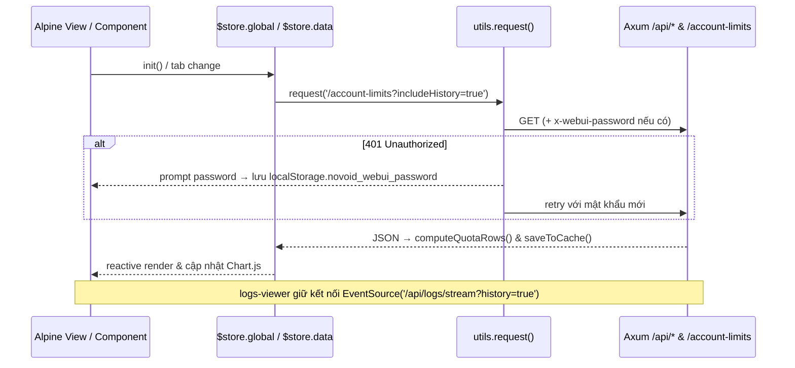

# 07 — WebUI (embedded frontend)

WebUI nằm hoàn toàn trong `public/` (36 file) và được nhúng trực tiếp vào binary lúc biên dịch qua `rust-embed` (`src/server/assets.rs`). Không có bước build JS riêng: chỉ cần sửa file trong `public/` rồi chạy `cargo build --release` (riêng `css/style.css` là file Tailwind đã biên dịch sẵn từ `css/src/input.css`).

## 1. Stack & cấu trúc tệp

| Thành phần | Vai trò |
| :--- | :--- |
| `public/index.html` | Shell Alpine.js: bootstrap theme sớm (`novoid_theme`), nạp Chart.js + Alpine.js (CDN) + Google Fonts + `css/style.css`, topbar/sidebar, toast, 5 container `x-load-view`, modal Add Account & OAuth progress, thứ tự nạp script |
| `public/css/src/input.css` | Nguồn Tailwind/DaisyUI: token màu 6-digit hex `--color-*` và `--rgb-*` cho `novoid-light` / `novoid-dark`, layout primitives, bảng, slider, skeleton |
| `public/css/style.css` | CSS minified (~196 KB) được nhúng vào runtime |
| `public/favicon.svg` | Icon SVG Novoid |
| `public/app.js` | Đăng ký `Alpine.data` components (`dashboard`, `models`, `accountManager`, `logsViewer`, `addAccountModal`, `app`), định nghĩa directive `x-load-view` (lazy load + cache template), polling auto-refresh theo `$store.settings.refreshInterval` |
| `public/js/config/constants.js` | `window.AppConstants`: intervals (`DASHBOARD_REFRESH = 300s`, `CONFIG_DEBOUNCE = 500ms`), `LIMITS` (`DEFAULT_LOG_LIMIT = 2000`, `ACCOUNT_BREAKDOWN_LIMIT = 10`), `VALIDATION` ranges, `UI` timings |
| `public/js/store.js` | `$store.global`: hash routing (`activeTab`, `settingsTab`), theme (`localStorage.novoid_theme`), i18n `t(key, params)`, toast (3s), `webuiPassword`, `fetchVersion()`, toàn bộ luồng `startOAuthFlow()` |
| `public/js/data-store.js` | `$store.data`: `accounts`, `models`, `modelConfig`, `quotaRows`, `usageHistory`, `maxAccounts`, `devMode`, cache `localStorage.novoid_data_cache` (TTL 24h), health check mỗi 15s (tạm dừng khi tab ẩn), `computeQuotaRows()`, `placeholderMode` |
| `public/js/settings-store.js` | `$store.settings`: tùy chọn UI lưu ở `localStorage.novoid_settings` (`refreshInterval`, `logLimit`, `showExhausted`, `showHiddenModels`, `showAllAccounts`, `compact`, `redactMode`, dev toggles), phát `refresh-interval-changed` |
| `public/js/utils.js` | `window.utils`: wrapper `request()` gắn header `x-webui-password` & tự prompt/lưu `localStorage.novoid_webui_password` khi `401`, `formatTimeUntil()`, `getThemeColor()`, `debounce()` |
| `public/js/utils/*` | `account-actions.js`, `error-handler.js` (`safeAsync`, `withLoading`), `model-config.js`, `redact.js` (che email/log ở screenshot mode), `ui-logger.js` (`?debug=true` / `novoid_debug`), `validators.js` |
| `public/js/components/*` | Component Alpine cho từng view và modal |
| `public/js/translations/*.js` | 6 bộ từ điển: `en`, `vi`, `zh`, `id`, `pt`, `tr` |
| `public/views/*.html` | Template lazy-loaded bởi `x-load-view`: `dashboard.html`, `models.html`, `accounts.html`, `logs.html`, `settings.html` |

## 2. Kiến trúc state & wiring

```
app.js (alpine:init + x-load-view)
 ├─ $store.global   (store.js)           → activeTab, settingsTab, theme, lang, toast, webuiPassword, OAuth flow
 ├─ $store.data     (data-store.js)      → accounts, models, quotaRows, usageHistory, healthCheck (15s), cache 24h
 ├─ $store.settings (settings-store.js)  → refreshInterval, logLimit, compact, redactMode, dev sub-toggles
 └─ Alpine.data components               → dashboard, models, accountManager, logsViewer, addAccountModal (+ serverConfig)
```

- **Lazy view loading:** `x-load-view` fetch `views/${viewName}.html?t=${Date.now()}`, lưu vào `window.viewCache`, chèn DOM và gọi `Alpine.initTree(el)`.
- **Theme:** `novoid-light` (mặc định) / `novoid-dark`, đọc ngay trong `<head>` để tránh chớp màn hình; các token `--color-*` phải giữ dạng hex 6 ký tự vì `dashboard/charts.js` nối thêm alpha suffix.
- **Screenshot/Redaction mode:** bật `redactMode` qua `$store.settings` sẽ ẩn email thật thành `Account N` trên Models, Accounts, Logs và khi export log.
- **Placeholder mode:** `$store.data.setPlaceholderMode()` tạo dữ liệu mẫu để demo/chụp ảnh màn hình.

## 3. Tab, component & API gọi

| Tab / Thành phần | View | Component chính | Endpoint sử dụng |
| :--- | :--- | :--- | :--- |
| Dashboard | `views/dashboard.html` | `dashboard.js`, `dashboard/stats.js`, `dashboard/charts.js` (Chart.js), `dashboard/filters.js` (`localStorage.dashboard_chart_prefs`) | Qua `$store.data` (`/account-limits?includeHistory=true`, `/api/config`) |
| Models | `views/models.html` | `models.js`, `utils/model-config.js` | `PATCH /api/accounts/:email` (drag threshold), `POST /api/models/config` (pin/hide/mapping) |
| Accounts | `views/accounts.html` | `account-manager.js`, `add-account-modal.js` | `POST /api/accounts/:email/refresh\|toggle`, `DELETE/PATCH /api/accounts/:email`, `POST /api/accounts/reload\|import`, `GET /api/accounts/export`, `GET /api/strategy/health`, `GET /api/auth/url\|status`, `POST /api/auth/complete` |
| Logs | `views/logs.html` | `logs-viewer.js` | `GET /api/logs/stream?history=true` (SSE, reconnect sau 3s, buffer `logLimit` mặc định 2000) |
| Settings | `views/settings.html` (1.267 dòng) | 3 sub-tab: Interface (`$store.settings`), Models (`window.Components.models()`), Server (`window.Components.serverConfig()`) | `GET/POST /api/config`, `POST /api/config/password`, `GET/POST /api/server/presets`, `PATCH/DELETE /api/server/presets/:name`, `POST /api/models/config` |

### Chi tiết hành vi nổi bật

- **`add-account-modal.js` & `store.js`:** Hỗ trợ cả callback cục bộ (mở popup, lắng nghe `window.message`, poll `/api/auth/status` mỗi 2s tối đa 60 lần) và chế độ `remote-loopback` (dán URL callback hoặc code vào `/api/auth/complete`). Khi `startOAuthFlow()` chạy, sự kiện `oauth-flow-started` đồng bộ URL/state với modal thủ công.
- **`account-manager.js`:** Toggle trạng thái account cập nhật lạc quan (optimistic) và rollback nếu lỗi; tài khoản có `source === "database"` là chỉ đọc trên UI; nút Fix mở `verifyUrl` nếu có hoặc kích hoạt OAuth lại; Health Inspector chỉ hiện khi server bật `devMode` và UI bật toggle.
- **`models.js`:** Kéo thả marker ngưỡng quota cập nhật lạc quan trên DOM; các marker cách nhau ≤2% được quạt lệch vị trí để không đè lên nhau.
- **`server-config.js`:** Debounce 500ms khi đổi trường số (`validateRange` với `AppConstants.VALIDATION`); trình sửa preset hỗ trợ cả form UI lẫn JSON thô và chặn sửa/xóa preset built-in.

## 4. Luồng dữ liệu WebUI



## 5. Thêm hoặc chỉnh sửa giao diện

1. Sửa template trong `public/views/` hoặc logic trong `public/js/`. Nếu sửa CSS token, chỉnh `public/css/src/input.css` rồi biên dịch lại `public/css/style.css`.
2. Nếu thêm chuỗi i18n, cập nhật cả 6 file trong `public/js/translations/{en,vi,zh,id,pt,tr}.js` (giữ nguyên các placeholder `{param}`).
3. Nạp file JS mới theo đúng thứ tự trong `public/index.html` (trước `public/app.js`).
4. Build lại bằng `cargo build --release` để `rust-embed` nhúng bản mới vào binary.
5. Kiểm tra trên trình duyệt cả trạng thái 0 account (`empty state`), dark/light mode và `?debug=true` (`UILogger`).
