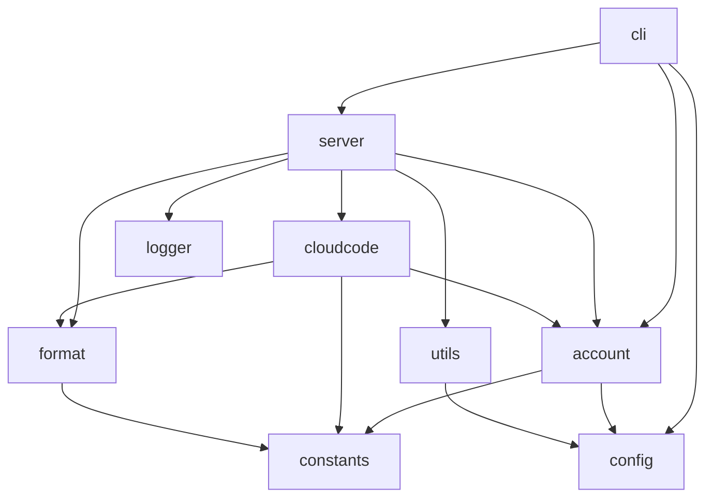

# 08 — Module Map (tham chiếu từng file)

Bảng dưới đây liệt kê **mọi file** trong repository (ngoại trừ `target/`, `.git/`). Để biết chi tiết hành vi, xem các tài liệu chuyên đề được link ở đầu mỗi nhóm.

## 1. Root

| File | Mô tả |
| :--- | :--- |
| `README.md` | Giới thiệu dự án, kiến trúc tóm tắt, hướng dẫn cài đặt nhanh, biến môi trường, link tới `novoid-proxy` |
| `Cargo.toml` | Crate `novoid-core` v2.7.7, edition 2021, MIT; dependencies: axum 0.7, tokio, reqwest (rustls), serde, clap, rust-embed, sha2, uuid, chrono, regex...; 2 binaries: `novoid-core`, `acc` |
| `Cargo.lock` | Lockfile dependency đã resolve |
| `.gitignore` | Loại trừ `target/`, file config local, secrets |
| `LICENSE` | MIT |
| `docs/` | Bộ tài liệu này (xem [docs/README.md](README.md)) |

### `docs/`

| File | Mô tả |
| :--- | :--- |
| `docs/README.md` | Index tài liệu + quy ước tên gọi |
| `docs/01-architecture.md` | Kiến trúc, sơ đồ Mermaid, vòng đời request, bảng trạng thái runtime |
| `docs/02-getting-started.md` | Build, CLI subcommands, khởi chạy lần đầu, kết nối client |
| `docs/03-configuration.md` | Schema `AppConfig`, env vars, presets, hằng số upstream |
| `docs/04-api-reference.md` | Route table, auth, error mapping, CORS/body limit |
| `docs/05-account-management.md` | OAuth PKCE, account type, chiến lược, trackers, cooldown |
| `docs/06-cloudcode-and-format.md` | Upstream retry/SSE, protocol conversion, schema & thinking |
| `docs/07-webui.md` | Stack frontend, stores, component, view, i18n |
| `docs/08-module-map.md` | File này — tham chiếu mọi file trong repo |
| `docs/09-operations.md` | Deploy, monitor, troubleshoot, backup, security |

## 2. `src/` — Rust core

| File | Mô tả | Chi tiết |
| :--- | :--- | :--- |
| `src/lib.rs` | Khai báo 10 module public: `account`, `cli`, `cloudcode`, `config`, `constants`, `error`, `format`, `logger`, `server`, `utils` | [01](01-architecture.md) |
| `src/main.rs` | Entrypoint binary `novoid-core`: khởi tạo tokio runtime + gọi `cli::run_cli()` | [02](02-getting-started.md) |
| `src/bin/acc.rs` | Entrypoint shorthand `acc`: cùng gọi `novoid_core::cli::run_cli()` | [02](02-getting-started.md) |
| `src/cli/mod.rs` | clap Parser/Subcommand: `start`, `stop`, `restart`, `status`, `ui`, `accounts`, `serve`; flags `--debug`, `--fallback`, `--strategy`; daemon PID, OAuth CLI, graceful shutdown | [02](02-getting-started.md) |
| `src/config.rs` | `AppConfig`, `AccountSelectionConfig`, các struct con; load/save `config.json` atomic, deep merge, env override, public config che secret | [03](03-configuration.md) |
| `src/constants.rs` | Endpoint Google, OAuth client/scope, path runtime, port callback, backoff, model alias/fallback, built-in presets, header client | [03](03-configuration.md) |
| `src/error.rs` | `NovoidError` enum + `to_anthropic_response()` map sang HTTP status/JSON chuẩn Anthropic | [04](04-api-reference.md) |
| `src/logger.rs` | Logger singleton: ring-buffer 1000 dòng + `broadcast::channel` cho SSE | [04](04-api-reference.md) |

### `src/account/`

| File | Mô tả |
| :--- | :--- |
| `src/account/mod.rs` | Re-export `AccountManager`, khai báo submodules |
| `src/account/types.rs` | `Account`, `AccountsFile`, `ModelRateLimit`, `QuotaInfo`, `SubscriptionInfo` (serde camelCase, field runtime `#[serde(skip)]`) |
| `src/account/storage.rs` | `load_accounts()` / `save_accounts()` atomic `.tmp` → rename |
| `src/account/manager.rs` | Trái tim account pool: init/reload, token & project cache, `get_project_for_account()` với onboard cooldown 10 phút, `fetch_and_save_subscription()` (không onboard), select_account, mark rate-limit/success/failure, status |
| `src/account/oauth.rs` | PKCE `get_authorization_url()`, `start_callback_server()` (51121 + fallback), `exchange_code()`, `refresh_access_token()`, `complete_oauth_flow()`, `discover_project_id()`, `onboard_user()`, `parse_refresh_parts()` |
| `src/account/strategy.rs` | `is_account_usable()`, `FallbackLevel`, `HybridStrategy` (score 4 thành phần + 4 nấc fallback), `Sticky`, `RoundRobin { cursor }`, diagnose no candidates |
| `src/account/trackers.rs` | `HealthTracker`, `TokenBucketTracker`, `QuotaTracker` |
| `src/account/rate_limits.rs` | Kiểm tra/đánh dấu cooldown per-account/per-model, clear expired, wait time tối thiểu |
| `src/account/model_support.rs` | Cache runtime model supported/unsupported (10 phút) |

### `src/cloudcode/`

| File | Mô tả |
| :--- | :--- |
| `src/cloudcode/mod.rs` | Khai báo submodules |
| `src/cloudcode/handler.rs` | `acquire_upstream_response()`, `send_message()`, `send_message_stream_prepared()`; vòng lặp account/endpoint, retry capacity/empty/5xx, fallback model |
| `src/cloudcode/request_builder.rs` | `build_cloudcode_request()`, `build_headers()`, identity scrub, prepend system prompt |
| `src/cloudcode/sse_streamer.rs` | `stream_sse_response()`, `parse_thinking_sse_response()`, `empty_response_fallback_events()` |
| `src/cloudcode/session_manager.rs` | `derive_session_id()` SHA-256 theo hội thoại + account, session store RAM |
| `src/cloudcode/model_api.rs` | Fetch model/quota, cache 5 phút single-flight, `/v1/models`, `get_subscription_tier()`, `parse_tier_id()`, validate model |
| `src/cloudcode/model_registry.rs` | Registry model built-in (family, supportsThinking, maxOutputTokens) |
| `src/cloudcode/rate_limit_parser.rs` | `parse_reset_time()` (header + `RetryInfo`), `parse_rate_limit_reason()` |
| `src/cloudcode/rate_limit_state.rs` | `get_rate_limit_backoff()`, `calculate_smart_backoff()`, background cleanup, helpers (banned/validation/capacity) |

### `src/format/`

| File | Mô tả |
| :--- | :--- |
| `src/format/mod.rs` | Re-export `convert_anthropic_to_google`, `convert_google_to_anthropic` |
| `src/format/request.rs` | Convert Anthropic request → Google payload; system, generation config, thinking config, tools |
| `src/format/content.rs` | `convert_role()`, `convert_content_to_parts()` (text/image/document/tool_use/tool_result/thought) |
| `src/format/response.rs` | Convert Google response → Anthropic JSON |
| `src/format/schema_sanitizer.rs` | `$ref`, `const`, `allOf`, `anyOf`/`oneOf`, type arrays, constraint hints → Google schema |
| `src/format/thinking.rs` | Thinking budget clamp, lọc signature, khôi phục thinking trong tool-loop, reorder blocks |
| `src/format/signature_cache.rs` | LRU tool/thinking signature + flush định kỳ ra `signature-store.json` |

### `src/server/`

| File | Mô tả |
| :--- | :--- |
| `src/server/mod.rs` | `AppState`, `build_router()`, middleware (auth API, auth WebUI, logging, CORS, body limit), handler `/v1/messages`, `/v1/models`, `/health`, `/account-limits`, `/refresh-token`, shutdown watch |
| `src/server/webui.rs` | Toàn bộ route `/api/*` + OAuth WebUI flow (`OAuthFlowStore`), account CRUD, config/presets, logs SSE |
| `src/server/assets.rs` | `rust-embed` serve `public/` (SPA fallback, static MIME) |

### `src/utils/`

| File | Mô tả |
| :--- | :--- |
| `src/utils/mod.rs` | `now_ms()`, `format_duration()` (hiện `ms` cho < 1s), `http_client()`, `maybe_throttle()` |
| `src/utils/claude_config.rs` | Đọc/ghi/khôi phục `~/.claude/settings.json`, đổi mode |
| `src/utils/server_presets.rs` | CRUD server preset (file `server-presets.json`) |
| `src/utils/usage_stats.rs` | Ghi/đọc `usage-history.json`, flush định kỳ |

## 3. `public/` — WebUI

| File | Mô tả |
| :--- | :--- |
| `public/index.html` | Shell Alpine.js: bootstrap theme sớm, nạp Chart.js/Alpine/CSS, topbar/sidebar, 5 container `x-load-view`, Add Account & OAuth progress modal |
| `public/app.js` | Đăng ký `Alpine.data` components, directive `x-load-view` lazy-load template, auto-refresh loop |
| `public/favicon.svg` | Favicon SVG Novoid |
| `public/css/src/input.css` | Nguồn Tailwind/DaisyUI + token màu 6-digit hex `--color-*` và `--rgb-*` cho `novoid-light`/`novoid-dark` |
| `public/css/style.css` | CSS minified đã biên dịch (~196 KB) |
| `public/js/config/constants.js` | `window.AppConstants`: intervals, limits, validation ranges, UI timings |
| `public/js/store.js` | `$store.global`: hash routing, theme, i18n `t()`, toast, webuiPassword, `startOAuthFlow()` |
| `public/js/data-store.js` | `$store.data`: accounts/models/quotaRows/usageHistory, cache 24h, health check 15s, placeholder mode |
| `public/js/settings-store.js` | `$store.settings`: UI preferences (`localStorage.novoid_settings`), `refresh-interval-changed` |
| `public/js/utils.js` | `window.utils`: `request()` (kèm prompt password 401), `formatTimeUntil()`, `getThemeColor()`, `debounce()` |
| `public/js/utils/account-actions.js` | Service gọi API CRUD account (`window.AccountActions`) |
| `public/js/utils/error-handler.js` | `window.ErrorHandler`: `safeAsync()`, `showError()`, `withLoading()` |
| `public/js/utils/model-config.js` | `window.ModelConfigUtils`: gọi `/api/models/config` + cập nhật lạc quan |
| `public/js/utils/redact.js` | `window.Redact`: che email và log trong screenshot/redact mode |
| `public/js/utils/ui-logger.js` | `window.UILogger`: console logger điều khiển qua `?debug=true` / `novoid_debug` |
| `public/js/utils/validators.js` | `window.Validators`: `validateRange()`, `validateTimeout()` |
| `public/js/components/dashboard.js` | Controller tab Dashboard (sync history, debounced charts, watchers) |
| `public/js/components/dashboard/stats.js` | `window.DashboardStats`: tính stats tài khoản/model/tier |
| `public/js/components/dashboard/charts.js` | `window.DashboardCharts`: Chart.js doughnut & usage trend |
| `public/js/components/dashboard/filters.js` | `window.DashboardFilters`: time range, display mode, family/model filter (`localStorage`) |
| `public/js/components/models.js` | Controller tab Models (quota rows, drag threshold markers, pin/hide) |
| `public/js/components/account-manager.js` | Controller tab Accounts (search, toggle, refresh, import/export, health inspector) |
| `public/js/components/add-account-modal.js` | Modal OAuth (local callback + dán callback URL/code thủ công) |
| `public/js/components/logs-viewer.js` | Viewer log SSE (`/api/logs/stream`), search regex/text, export |
| `public/js/components/server-config.js` | Controller Server tab trong Settings (config runtime, password, server presets) |
| `public/js/translations/en.js` | Tiếng Anh |
| `public/js/translations/vi.js` | Tiếng Việt |
| `public/js/translations/zh.js` | Tiếng Trung |
| `public/js/translations/id.js` | Tiếng Indonesia |
| `public/js/translations/pt.js` | Tiếng Bồ Đào Nha (PT-BR) |
| `public/js/translations/tr.js` | Tiếng Thổ Nhĩ Kỳ |
| `public/views/dashboard.html` | HTML tab Dashboard |
| `public/views/models.html` | HTML tab Models |
| `public/views/accounts.html` | HTML tab Accounts |
| `public/views/logs.html` | HTML tab Logs |
| `public/views/settings.html` | HTML tab Settings (3 sub-tab: Interface, Models, Server; 1.267 dòng) |

Chi tiết wiring/XData/API: xem [07 — WebUI](07-webui.md).

## 4. Sơ đồ phụ thuộc module (Rust)

## 5. Quy ước khi thêm file

- File Rust mới: khai báo `pub mod` trong `lib.rs` hoặc module cha tương ứng.
- File JS/CSS/HTML mới trong `public/`: tự động được nhúng bởi `rust-embed`; cần include vào `index.html` (script/link) hoặc import từ component.
- Thêm route: cập nhật `src/server/mod.rs` hoặc `webui.rs`, rồi cập nhật [API Reference](04-api-reference.md) + [Module Map](08-module-map.md).
- Thêm cấu hình: thêm field vào `AppConfig` với `#[serde(default)]`, cập nhật [Configuration](03-configuration.md).
